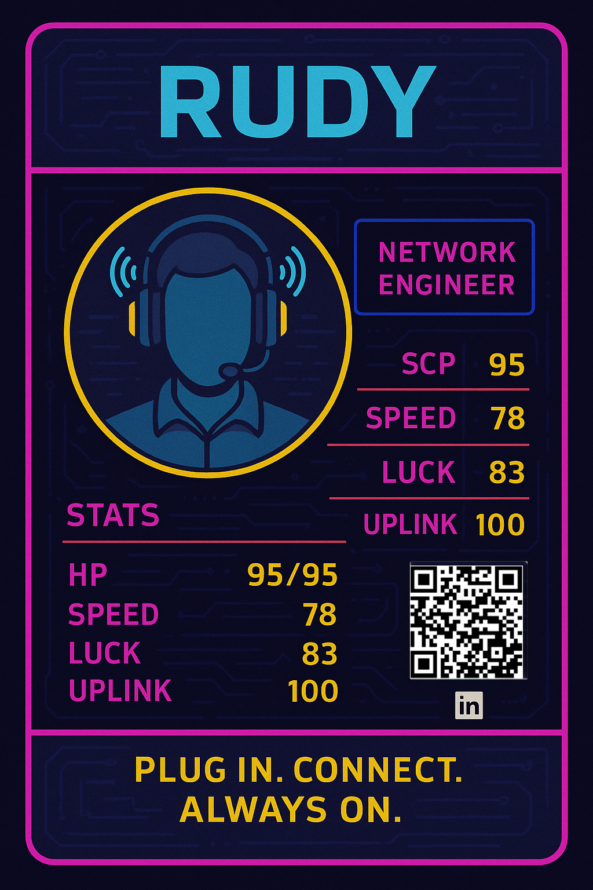

  

<h3 align="center">🛰️ Fullstack Dev • 🌐 Network Ops • 🛠️ Infrastructure-Aware Engineer</h3>

  

  
  
  
  

---

## 🦾 System Identity

> Side Quest: survive the network, survive the deadline.  
> Main Quest: pretend everything is fine.

**Buffs Applied:**
- ☕ **3x Kopi Tubruk** (Brain Overclock)
- 🔧 **7x StackOverflow & Docs** (Ancient Wisdom)
- 🔄 **CTRL+ALT+Z** (Time Reversal)
- ⌛ **Latency Immunity** (SLA >99%, mostly stable)

**Passives:**
- OTDR & Optical Power Instinct
- Can spot a red LOS blink from 30 meters
- +5 sarcasm when bug or outage appears

---

## 🔥 Role & Skills

🪪 **Alias:** `rudy`  
🧭 **Class:** Fullstack Dev × Network Operation Engineer  
🛰️ **Specialty:** Making systems that shouldn't work… work anyway *(code that understands the fiber below)*

🧠 **Skill Tree:**
- Laravel / React / TypeScript / REST API
- Docker / Linux Server / Nginx
- MikroTik RouterOS / VLAN / PPPoE / Queue Tree
- FTTH Optics (OLT/ONT, ODP–ODC–FTM, Splicing)
- Debugging at 2 AM with coffee & regret

🧯 **Ultimate:**  
`fix: I don't know how, but it works now`

---

## 🚀 Mission

> “Integrate or die trying.”

Everything must talk:
- Web Apps
- Networks & Optical Nodes
- Containers
- Databases

If they don’t communicate?  
I stand behind them with coffee and threats.

---

## ⚡ Personality Patch Notes

- Calm under pressure  
- Laughs at error messages  
- Treats warnings as friendly suggestions  
- Believes clean logs beat guesswork (most of the time)

If system goes boom:
> “Cool, new challenge.”

---

## 📡 Active Zone

🌏 Based in Banjarmasin, Indonesia  
📡 Currently keeping Distribution & Access ops alive @ **Biznet**  
🐳 Shipping **Laravel · React · Docker** apps & internal tooling  
🎮 Side hobby: staring at fiber patch panels, MikroTik logs & home lab cables  

---

## ☣️ Tech Stack

  
  
  
  
  
  
  
  
  
  

---

## 🧠 Life Philosophy

> If it breaks, cool.  
> Now I get to fix it.

> If nothing breaks, I'm suspicious.

---

## 🔗 Neural Link

  
  &nbsp;&nbsp;&nbsp;
  

  Left: <a href="https://rudy0317.github.io/rudy-dev/">Portfolio</a> · Right: <a href="https://www.linkedin.com/in/rudyyy">LinkedIn</a>

---

  <code>"Hack. Patch. Deploy. Repeat."</code> 
  (and pray nothing explodes)

  

